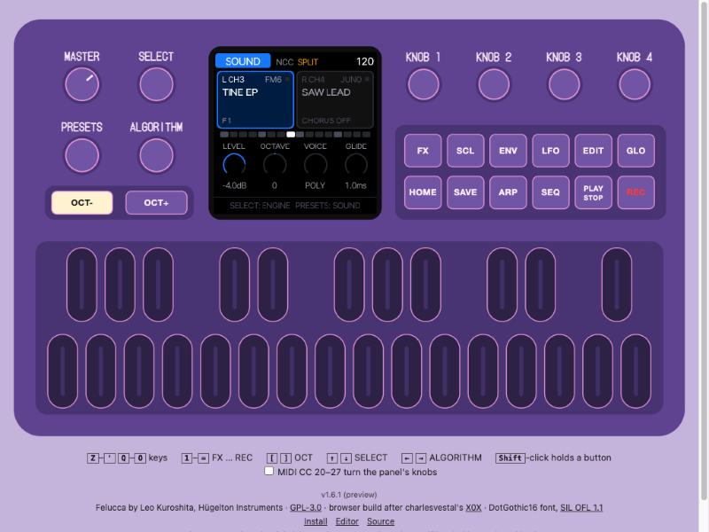

# NCC manual

NCC (Novation Circuit Companion) turns the M-VAVE FM-1 into a two-part sound module for the Novation Circuit Tracks.
The Circuit plays the notes and turns the knobs; the FM-1 makes the sounds and gives you the controls for playing live.



- [Hooking it up](#hooking-it-up)
- [The two parts](#the-two-parts)
- [The screen](#the-screen)
- [Sounds and engines](#sounds-and-engines)
- [Drum loops (LOOP)](#drum-loops-loop)
- [The Circuit's 8 knobs](#the-circuits-8-knobs)
- [Arp and HOLD](#arp-and-hold)
- [Drone](#drone)
- [Effects (FX)](#effects-fx)
- [Split or stereo](#split-or-stereo)
- [Button cheat sheet](#button-cheat-sheet)
- [Installing](#installing)
- [Tips](#tips)

## Hooking it up

**MIDI.** Send the Circuit Tracks' MIDI to the FM-1's USB MIDI port (through a USB MIDI host adapter, or your computer
passing the Circuit's MIDI on). NCC listens on:

| Circuit Tracks track | MIDI channel | FM-1 part |
|---|---|---|
| MIDI 1 | 3 | **L** (FM6 to start with) |
| MIDI 2 | 4 | **R** (JUNO to start with) |

Use the Circuit's **factory MIDI template** on both MIDI tracks: its 8 macro knobs then send exactly the CCs NCC
expects (1, 2, 5, 11, 71, 74, 12, 13). NCC follows the Circuit's **clock and Start/Stop** over USB; with no clock
coming, the arp runs at the FM-1's own BPM.

**Audio.** Run a stereo-to-2×mono Y-cable from the FM-1's output into the Circuit's **audio inputs 1 and 2**. By default
part L is on the left channel only and part R on the right only, so each part arrives on its own Circuit input (see
[Split or stereo](#split-or-stereo)).

Then program notes on the Circuit's MIDI 1 and MIDI 2 tracks, press Play, and turn the Circuit's knobs.

## The two parts

The FM-1 has two parts, **L** (blue) and **R** (pink). Each has its own engine, sound, arp, drone and sends.

- **OCT-** puts the focus on **L**, **OCT+** on **R**. The FM-1's keys, its 4 knobs and its buttons always act on
  the part in focus. This is the quick way to jump between your two sounds while jamming.
- The Circuit always plays both parts, whichever has the focus.
- Up to 8 voices are shared between the two parts.

## The screen

- **Top bar:** the page (SOUND, ARP, or an FX page), `SPLIT` or `ST` (stereo), and the tempo (amber when it follows
  the Circuit's clock).
- **The two part boxes:** channel, engine and sound name of L and R. The part in focus is highlighted. A row of dots
  below shows the steps of the bar.
- **KNOB 1–4:** what the FM-1's own four knobs do on this page, with their values.
- **Bottom line:** a hint for the page, or a popup. When you turn a Circuit knob it shows the Circuit's label and
  what it does on that engine with the live value, for example `R FILTER FREQ   CUTOFF 2.1kHz`.

## Sounds and engines

NCC puts the sounds of all six engines in **one library**, sorted by what you use them for: **BASS, PAD, LEAD,
KEYS, PLUCK, BEAT**. You choose a sound by its role; the engine follows. On the **SOUND** page (press **HOME**):

| Control | What it does |
|---|---|
| **SELECT** (knob) | The **type** filter: ALL, BASS, PAD, LEAD, KEYS, PLUCK. |
| **ALGORITHM** (knob) | The **engine** filter: ALL, FM6, JUNO, PHASE, TRIO, ACID. |
| **PRESETS** (knob) | Steps through the sounds that pass both filters, across engines. It loads once you stop turning, so you can scroll freely. |
| KNOB 1–4 | LEVEL, OCTAVE, VOICE (poly / mono / legato ...), GLIDE |

- When you stop turning SELECT or ALGORITHM, the part keeps its sound if it fits the new filter; otherwise the first
  sound that fits loads, so you hear the change right away. Types or engines with no matching sound are skipped
  (ACID has no pads, for example).
- A sound from another engine switches the part to that engine automatically.
- Each part has its own filters, shown at the bottom of its box (`PAD / ALL`).
- Your own sounds join in: user presets and a DX7 bank loaded into FM6 get their type from their name ("E.PIANO" is
  KEYS, "STRINGS" is PAD). Sounds whose name doesn't tell show up under **OTHER**.
- The Juno chorus lives on **FX > CHORUS** (KNOB 3).

There are 88 built-in sounds: 18 BASS, 15 PAD, 20 LEAD, 13 KEYS, 15 PLUCK, 7 BEAT (drum loops).

### More FM sounds: load a DX7 bank

FM6 plays real DX7 voices. Thousands of DX7 banks (`.syx`, 32 voices each) are around, for example the archive on
[Dave Benson's DX7 page](https://homepages.abdn.ac.uk/d.j.benson/pages/html/dx7.html). To load one, connect the
FM-1 by USB, open Felucca's [web editor](https://hugelton.github.io/Felucca/webapp/editor/) in Chrome or Edge and
import the `.syx` in its FM6 section. The bank's 32 voices then show up in NCC's library under FM6, sorted into
types by their names ("E.PIANO 1" is KEYS, "SYN-BASS 1" is BASS, "STRINGS 1" is PAD, "TUB BELLS" is PLUCK).

The six engines:

| Engine | Character | Example sounds |
|---|---|---|
| **FM6** | 6-operator FM in the style of the DX7: e-pianos, bells, basses, brass. Loads DX7 banks (via Felucca's web editor). | TINE EP, BELL, FM BASS, BRASS, PAD, MARIMBA |
| **JUNO** | Analog-style poly synth with a Juno-style chorus and drift, plus a set of Juno sounds. | JUNO STRINGS, JUNO PAD, JUNO EP, FUNK CLAV, HOUSE KEYS, DREAM PAD, HOOVER |
| **PHASE** | Casio CZ-style phase distortion: bright, glassy, a bit raw. | PD EP, DIGI PIANO, GLASS BELL, MALLET, PD BASS, FOLD LEAD |
| **TRIO** | Three oscillators and a multimode filter, in the spirit of the C64's SID chip. | CHIP BASS, WOBBLE BASS, CHIP KEYS, TOY PIANO, 8BIT PAD, CHIP LEAD |
| **ACID** | A 303-style bass: saw or square, a squelchy filter, accents on loud notes (velocity 100+), slides on overlapping notes. | ACID 303, SQUELCH, DEEP BASS, SOFT BASS, ACID LEAD, ACID PLUCK |
| **LOOP** | Lo-fi one-bar drum loops that always fit the bar, with IDM-style glitch tricks on the knobs. See [Drum loops](#drum-loops-loop). | JUNGLE BREAK, AMEN-ISH BREAK, BOOM BAP BEAT, TWO STEP BEAT, FOUR FLOOR BEAT, ELECTRO BEAT, IDM GLITCH BEAT |

## Drum loops (LOOP)

The LOOP engine plays one-bar drum loops in time with the Circuit. Pick one with SELECT on **BEAT** (or ALGORITHM on
**LOOP**); each loop is its own sound.

- **Always in the bar.** The loop is cut into 16 slices, and each one starts on its 16th of the Circuit's clock. At
  any tempo it stays exactly one bar long, without changing pitch (a slower tempo leaves a little air after each
  slice, a faster one cuts them short).
- **A note is a gate.** Any note, at any pitch, opens the loop **where the bar is right now**, and the note-off closes
  it. The Circuit's scale and key don't matter. So the Circuit's step sequencer becomes the loop's rhythm: one long
  note plays the whole bar; short notes on a few steps chop a new groove out of it. Velocity sets the level.
  **HOLD** or **Drone** keep it open.
- **Lo-fi on purpose:** 11 kHz, 8 bits. The built-in loops are made from Felucca's own drum sounds. AMEN-ISH BREAK
  plays the famous break's rhythm on those sounds; the original recording is not included (it is copyrighted).

The Circuit's knobs on a loop:

| Circuit knob | LOOP |
|---|---|
| 1 OSCILLATOR | **Pitch**: the slices faster or slower (±12 semitones), still one per 16th |
| 2 OSC MOD | **Shuffle**: each slice's chance to be another slice of the bar |
| 3 AMP ENV | **Gate**: how much of each slice plays, down to blips |
| 4 FILTER ENV | **Reverse**: each slice's chance to play backwards |
| 5 FILTER FREQ | **DJ filter**: left a low-pass, right a high-pass |
| 6 RESONANCE | **Crush**: fewer bits, a lower sample rate |
| 7 MODULATION | **Stutter**: first random ratchets (2–4 hits in a 16th), further up a beat repeat of 1/8, 1/16, 1/32, 1/64 |
| 8 FX | Drive + delay send |

## The Circuit's 8 knobs

Each Circuit macro knob is mapped to what its label means on that engine. Knob in the middle (64) = the sound as
loaded; turn either way to move away from it. When you load a new sound, the knobs start again from the middle.
Moves are smoothed, so sweeps don't zipper.

| Circuit knob | FM6 | JUNO | PHASE | TRIO | ACID |
|---|---|---|---|---|---|
| 1 OSCILLATOR | operator ratios | osc mix (sub level on SUB) | waveform | osc 2 interval | saw / square |
| 2 OSC MOD | feedback | osc 2 detune (sync on SYNC) | detune | pulse width + detune | accent amount |
| 3 AMP ENV | carrier envelope times | attack + release | attack + release | attack + release | decay + release |
| 4 FILTER ENV | modulator envelope | envelope to filter | envelope to DCW | envelope to filter | env mod + decay |
| 5 FILTER FREQ | brightness | cutoff | DCW (brightness) | cutoff | cutoff |
| 6 RESONANCE | detune | resonance | wave fold | resonance | resonance |
| 7 MODULATION | LFO on brightness + a little vibrato | LFO on filter + rate | LFO on DCW + rate | LFO on filter + rate | slide time |
| 8 FX | drive + chorus send | drive + chorus send | drive + chorus send | drive + chorus send | drive + delay send |

If you change a value on the FM-1 itself while a Circuit knob is turned, your FM-1 setting stays, and the Circuit
knob keeps working on top of it.

## Arp and HOLD

- **ARP** switches the arp on for the part in focus and opens the **ARP** page. Press ARP again on that page to switch
  it off.
- KNOB 1–4: MODE (UP, DN, UPDN, RND, ORD, CHORD and more), RATE (1/4 to 1/32, triplets), OCTAVES, GATE. Turn
  **SELECT** for page 2: SWING, PROB, ORDER.
- The arp is always locked to the Circuit's clock. A new chord starts on the next step of the grid, so it stays in time.
- **REC** = **HOLD**: the arp keeps playing after you let go. A new chord replaces the held one; press REC again to
  release.
- The Circuit's **Stop** stops the arp.

## Drone

**SEQ** = **Drone** for the part in focus. With Drone on, notes keep sounding after their note-off: build up a pad
from the Circuit or the FM-1's keys and jam over it. Play a droning note again to let it go; press SEQ again to
release everything. The Circuit's **Stop** releases the drone too (Drone stays switched on for the next notes).

## Effects (FX)

**Tap FX** to open the effects. Each further tap of FX (or a turn of **SELECT**) goes to the next page; the tap after
the last page closes FX. **HOME** or **ARP** close it at once.

| Page | KNOB 1 | KNOB 2 | KNOB 3 | KNOB 4 |
|---|---|---|---|---|
| **SENDS** (part in focus) | DRIVE | CHORUS send | DELAY send | REVERB send |
| **DELAY** | TIME (synced) | FEEDBACK | COLOR | MIX |
| **REVERB** | TYPE (ROOM / SPRING / HALL) | SIZE | DAMP | reverb SEND of the part |
| **CHORUS** | RATE | DEPTH | JUNO chorus of the part | DRIFT of the part |
| **INSERT** (part in focus) | TYPE (SOFT, HARD, FOLD, FUZZ, CRUSH, PHASER, FLANGER, CHORUS) | A | B | C (named per type) |
| **PERFORM** | FILTER | CRUSH | THROW | DEPTH |

While FX is open, the **white keys** play Felucca's PERFORM effects instead of notes: beat repeats (1/8, 1/16,
1/32), reverse, low-pass and high-pass sweeps, tape stop, freeze, octave shimmer, flanger, phaser and throws. Each
effect lasts as long as you hold its key. The PERFORM page shows which key does what.

**Throws, on every page:** hold **ENV** for an echo throw, hold **LFO** for a reverb throw.

## Split or stereo

- **SPLIT** (the default): part L only on the left output, part R only on the right. The dry sounds stay fully
  apart, so each part goes to its own Circuit input. The delay, reverb and chorus are shared by both parts, so
  their tails come out on both sides.
- **STEREO**: both parts in stereo on both outputs, for headphones or a single input.
- **GLO + SEQ** toggles between them; the top bar shows `SPLIT` or `ST`.

## Button cheat sheet

| Button / knob | Action |
|---|---|
| OCT- / OCT+ | Focus on part L / part R |
| HOME | SOUND page |
| PRESETS | Choose the part's sound (within the filters) |
| SELECT | SOUND page: type filter. ARP / FX: next page |
| ALGORITHM | Engine filter |
| ARP | Arp on + ARP page / off |
| REC | Arp HOLD |
| SEQ | Drone |
| GLO + SEQ | SPLIT ↔ STEREO |
| FX | Open effects, next page, close |
| ENV (hold) | Echo throw |
| LFO (hold) | Reverb throw |
| Keys | Play the part in focus (with FX open: PERFORM effects) |

Your parts, engines, sounds and effect settings are kept by Felucca's autosave.

## Installing

Installing firmware is at your own risk, but the way back is easy: M-VAVE's own updater, or Felucca's
[web installer](https://hugelton.github.io/Felucca/) with **Return to official V15**.

1. Get the package: `ncc-0.1.fwsc` (or the newest `ncc-X.Y.fwsc`) from the [Releases](https://github.com/fenderberg/fm1-nc-companion/releases) page, or
   build it yourself (`FELUCCA_LIVEUI=1 ./build.sh`, see [BUILDING.md](../BUILDING.md)).
2. Connect the FM-1 by USB and install with the command-line installer (Python 3 with `pip3 install mido
   python-rtmidi`):

   ```bash
   python3 tools/fm1_install.py ncc-0.1.fwsc
   ```

3. The FM-1 restarts into NCC (identity `FM-1_701` for release 0.1; NCC uses `FM-1_7XY`). Check with `python3 tools/fm1_install.py --info`.

If an install is ever cut off, run the same command again, or hold **OCT-** while switching on to reach the updater.

## Tips

- Put a pad on L with **Drone** on, and an ACID line on R. Ride R's FILTER FREQ and RESONANCE on the Circuit while
  the pad rings.
- Tap **FX** once and you're on SENDS: a quick way to add delay to just one part.
- Hold **ENV** on the last beat before a break for an echo throw.
- Set SELECT to PAD and leave ALGORITHM on ALL: PRESETS then walks through every pad of every engine.
- Load your own DX7 bank into FM6 with Felucca's [web editor](https://hugelton.github.io/Felucca/webapp/editor/):
  its voices appear in the library by type.
- No Circuit at hand? `DEMO=1 sh tools/ncc_demo.sh` builds the browser emulator with a built-in player.
