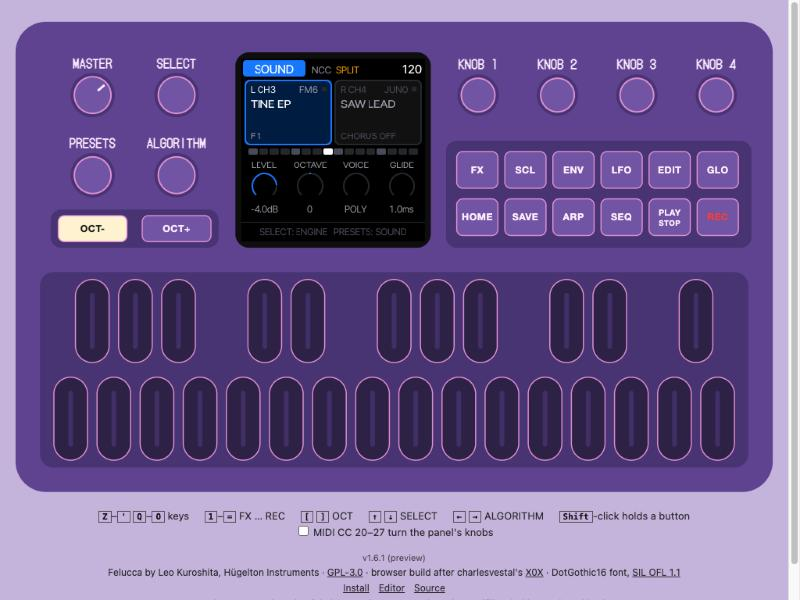

# NCC manual

NCC (Novation Circuit Companion) turns the M-VAVE FM-1 into a two-part sound module for the Novation Circuit Tracks.
The Circuit plays the notes and turns the knobs; the FM-1 makes the sounds and gives you the controls for playing live.

This manual follows **NCC 0.7** (`FM-1_707`). Coming from an older version? Since 0.7 you change pages with the page's
own button (**FX**, **GLO**, **EDIT**: tap for the next page, hold for the previous one, both round) and the arp's pages
with **KNOB 4**; in 0.5 and 0.6 that was **PLAY**, in 0.4 turning SELECT.
What changed when: [CHANGELOG.md](../CHANGELOG.md).



- [Hooking it up](#hooking-it-up)
- [The two parts](#the-two-parts)
- [Dual: play both sounds together](#dual-play-both-sounds-together)
- [The screen](#the-screen)
- [Sounds and engines](#sounds-and-engines)
- [Coming soon: drum loops](#coming-soon-drum-loops)
- [The Circuit's 8 knobs](#the-circuits-8-knobs)
- [Arp and HOLD](#arp-and-hold)
- [Drone](#drone)
- [Settings (GLO)](#settings-glo)
- [Editing sounds (EDIT)](#editing-sounds-edit)
- [Effects (FX)](#effects-fx)
- [Split or stereo](#split-or-stereo)
- [Button cheat sheet](#button-cheat-sheet)
- [NCC Manager (web page)](#ncc-manager-web-page)
- [Installing](#installing)
- [Tips](#tips)

## Hooking it up

**MIDI.** Send the Circuit Tracks' MIDI to the FM-1's TRS MIDI input, or use USB MIDI through a USB host adapter or
a computer passing the MIDI on. NCC listens on:

| Circuit Tracks track | MIDI channel | FM-1 part |
|---|---|---|
| MIDI 1 | 3 | **L** (FM6 to start with) |
| MIDI 2 | 4 | **R** (JUNO to start with) |

Use the Circuit's **factory MIDI template** on both MIDI tracks: its 8 macro knobs then send exactly the CCs NCC
expects (1, 2, 5, 11, 71, 74, 12, 13). NCC follows the Circuit's **clock and Start/Stop** over USB (the default) or
TRS; pick the source on **GLO > SETUP**, KNOB 4. With no clock coming in, the arp runs at the FM-1's own tempo.

**Audio.** Run a stereo-to-2×mono Y-cable from the FM-1's output into the Circuit's **audio inputs 1 and 2**. Part L
comes out on the left only and part R on the right only, so each part arrives on its own Circuit input (see
[Split or stereo](#split-or-stereo)).

Then program notes on the Circuit's MIDI 1 and MIDI 2 tracks, press Play, and turn the Circuit's knobs.

## The two parts

The FM-1 has two parts, **L** (blue) and **R** (pink). Each has its own engine, sound, arp, drone and sends.

- **OCT-** puts the focus on **L**, **OCT+** on **R**. The FM-1's 4 knobs and its buttons act on the part in focus;
  its keys play that part. This is the quick way to jump between your two sounds while jamming.
- The Circuit always plays both parts, whichever has the focus.
- The two parts share 8 voices.

## Dual: play both sounds together

Dual lets one Circuit track play **both** parts at once: an arp on L and a pad on R from the same notes, for example.

- Press **SCL** (the small button beside FX) to switch Dual on or off. The top bar shows `D3` or `D4` and the SCL
  light stays on.
- `D3` means the notes of MIDI channel 3 (the Circuit's MIDI 1) play both parts; `D4` the notes of channel 4. The
  other channel's notes are ignored while Dual is on. The FM-1's keys play both parts too.
- Choose CH3 or CH4 on **GLO > SETUP 2**, KNOB 1, or in the Manager. SCL remembers your choice.

Each part keeps its own sound, arp, HOLD and Drone, and OCT- / OCT+ still choose which part the panel edits. Dual
shares **notes only**: the Circuit's knobs, pitch bend and sustain still go to their own part, so both sets of knobs
keep working. Switching Dual on or off fades out what is playing; strike the keys again to carry on.

## The screen

- **Top bar:** the page (SOUND, ARP, an FX page ..), `SPLIT` or `ST` (stereo), `D3` / `D4` when Dual is on, and the
  tempo (amber when it follows the Circuit's clock).
- **The two part boxes:** channel, engine and sound name of L and R, and two labels with the part's category and engine
  filter (`PAD` `ALL`). The part in focus is highlighted. A row of dots shows the steps of the bar.
- **KNOB 1–4:** what the FM-1's own four knobs do on this page, with their values.
- **Bottom line:** on the SOUND page, the focused part's category, engine and place in the list (`TYPE PAD   ENGINE ALL
  3/10`); on other pages a hint. When you turn a Circuit knob it shows the knob's label, what it does on that engine
  and the live value, for example `R FILTER FREQ   CUTOFF 2.1kHz`.

## Sounds and engines

NCC puts the sounds of all twelve engines in **one library**, sorted by what you use them for: **BASS, PAD, LEAD,
KEYS, PLUCK, BEAT**. You choose a sound by its role; the engine follows. Three knobs, one job each, on every page (the
**SOUND** page, press **HOME**, shows where you are going):

| Control | What it does |
|---|---|
| **SELECT** (knob) | The **category**: ALL, BASS, PAD, LEAD, KEYS, PLUCK, BEAT (OTHER for names it can't place), and **USER**: all your own sounds. |
| **ALGORITHM** (knob) | The **engine**: ALL, FM6, JUNO, PHASE, TRIO, ACID, PHYS, GRAIN, VOICE, LOFI, WHEEL, NOISE, SAMPLE. |
| **PRESETS** (knob) | The **sound**, among those of that category and engine. It loads once you stop turning, so you can scroll freely. |
| KNOB 1–4 | LEVEL, OCTAVE, VOICE (poly / mono / legato ..), GLIDE |

- The three knobs **stop at the ends**: turn back to go back. The bottom line says `(FIRST)` or `(LAST)`.
- While you turn, the screen shows in amber where you're going: the category or engine and how many sounds it has, or
  for PRESETS the name of the sound you'll land on.
- When you change the category or engine, the part keeps its sound if it fits; otherwise the first sound that fits
  loads, so you hear the change right away. Combinations with no sounds are skipped (ACID has no pads).
- Your own sounds join in: a sound you save on the FM-1 keeps the category it had, and also shows under **USER**. Other
  user presets and a DX7 bank in FM6 get their category from their name ("E.PIANO" is KEYS, "STRINGS" is PAD).
- A newly chosen sound starts **dry**: its delay and reverb sends at zero, so it never arrives drenched in the effects of
  the sound before. Turn them up on **FX > SENDS** whenever you like.

There are **161 built-in sounds**: 25 BASS, 40 PAD, 36 LEAD, 29 KEYS, 27 PLUCK and 4 BEAT.

### Save your own sound

Shaped a sound you like, with the Circuit's knobs or on EDIT? Keep it in the FM-1's **user bank** (32 places):

1. Press **SAVE**. The bottom line asks what to do, for four seconds.
2. Press **SAVE** again:
   - **tap**: overwrite. This works on a sound you saved before (`OVERWRITE? HOLD: NEW`); it keeps its name.
   - **hold** (half a second): a **new** sound. It is named after the sound it came from ("SOFT PAD" becomes
     "SOFT PAD 2", a copy of that "SOFT PAD 3") and goes in the same category, and under **USER**.
   A built-in or DX7 sound can't be overwritten: the screen says `HOLD SAVE: NEW SOUND`.
3. The screen says `SAVED:` and the name. The part now plays your sound, so the next SAVE + tap updates it.

Any other button, or four seconds of waiting, cancels (`SAVE CANCELLED`). What is saved is the sound as you hear it,
Circuit knobs included: load it again and the knobs start from the middle, which is now your sound. Saving works while
the Circuit plays, but writing to the FM-1's memory stops the sound for a moment (about 50 ms) and the arp may skip a
step. A full bank says `USER BANK FULL`. Rename, erase and back up your sounds in the [Manager](#ncc-manager-web-page).

The twelve engines:

| Engine | Character | Example sounds |
|---|---|---|
| **FM6** | 6-operator FM in the style of the DX7: e-pianos, bells, basses, brass. Plays DX7 banks. | TINE EP, BELL, FM BASS, BRASS, PAD, MARIMBA |
| **JUNO** | Analog-style poly synth with a Juno-style chorus and drift. | JUNO STRINGS, JUNO PAD, JUNO EP, FUNK CLAV, HOUSE KEYS, HOOVER |
| **PHASE** | Casio CZ-style phase distortion: bright, glassy, a bit raw. | PD EP, DIGI PIANO, GLASS BELL, MALLET, PD BASS, FOLD LEAD |
| **TRIO** | Three oscillators and a multimode filter, in the spirit of the C64's SID chip. | CHIP BASS, WOBBLE BASS, CHIP KEYS, TOY PIANO, 8BIT PAD |
| **ACID** | A 303-style bass: a squelchy filter, accents on loud notes (velocity 100+), slides on overlapping notes. | ACID 303, SQUELCH, DEEP BASS, ACID LEAD, ACID PLUCK |
| **PHYS** | Physical models: plucked and bowed strings, struck bodies, drums. | STEEL PLUCK, BOWED PAD, HARP PLUCK, ROUND BASS, DEEP TOM |
| **GRAIN** | Granular clouds and textures. | MIST PAD, FROST PAD, HALO PAD, DUST PLUCK, GLITCH LEAD |
| **VOICE** | Sung vowels: aahs, oohs, breath and buzz. | AAH PAD, OOH PAD, AIR PAD, VOWEL LEAD, TALK BASS |
| **LOFI** | Old game-console chips: pulse waves, wave RAM, stepped envelopes. | PULSE BASS, TRI KEYS, RAM LEAD, CHIP PAD, STEP PLUCK |
| **WHEEL** | Tonewheel organ with drawbars, percussion and a rotating speaker. | SOUL ORGAN, DUB ORGAN, GOSPEL KEYS, ROCK ORGAN |
| **NOISE** | Wind, rain, radio static and metallic noise through a resonant filter. | WIND PAD, RAIN PAD, RADIO PAD, METAL PLUCK, BUZZ BASS |
| **SAMPLE** | Built-in piano, flute and sax, or your own samples. | SOFT PIANO, DUST PIANO, FLUTE PAD, SAX LEAD |

PHYS, GRAIN and VOICE are heavier on the chip, so they play fewer notes at once (three or four per part).

### More FM sounds: load a DX7 bank

FM6 plays real DX7 voices. Thousands of DX7 banks (`.syx`, 32 voices each) are around, for example the archive on
[Dave Benson's DX7 page](https://homepages.abdn.ac.uk/d.j.benson/pages/html/dx7.html). Drop one on the **DX7 bank**
tab of the [NCC Manager](#ncc-manager-web-page) and send it to the FM-1: its 32 voices show up in the library under
FM6, sorted by their names ("E.PIANO 1" is KEYS, "SYN-BASS 1" is BASS, "STRINGS 1" is PAD). A new bank replaces the
old one; **Remove the bank** takes it off. A part playing one of its voices keeps that sound.

## Coming soon: drum loops

A LOOP engine with lo-fi one-bar drum loops is in the works: always in time with the Circuit's bar, started by any note,
chopped by the Circuit's steps, with shuffle, reverse, stutter and crush on the knobs. It is left out until it's done.

## The Circuit's 8 knobs

Each Circuit macro knob does what its label says, on every engine. Knob in the middle = the sound as loaded; turn
either way to move away from it. When you load a new sound, the knobs start from the middle again. Moves are smoothed,
so sweeps don't zipper, and the screen tells you what each knob does.

| Circuit knob | FM6 | JUNO | PHASE | TRIO | ACID |
|---|---|---|---|---|---|
| 1 OSCILLATOR | operator ratios | osc mix | waveform | osc 2 interval | saw / square |
| 2 OSC MOD | feedback | osc 2 detune | detune | pulse width + detune | accent amount |
| 3 AMP ENV | decay + release (attack kept) | release | release | release | decay + release |
| 4 FILTER ENV | modulator envelope | envelope to filter | envelope to brightness | envelope to filter | env mod + decay |
| 5 FILTER FREQ | brightness | cutoff | brightness | cutoff | cutoff |
| 6 RESONANCE | detune | resonance | wave fold | resonance | resonance |
| 7 MODULATION | LFO + a little vibrato | LFO on filter | LFO on brightness | LFO on filter | slide time |
| 8 FX | drive + chorus | drive + chorus | drive + chorus | drive + chorus | drive + delay |

| Circuit knob | PHYS | GRAIN | VOICE |
|---|---|---|---|
| 1 OSCILLATOR | structure / harmonics | sample position | vowel |
| 2 OSC MOD | strike position | grain size | buzz |
| 3 AMP ENV | release | release | release |
| 4 FILTER ENV | envelope to brightness | envelope to tone | envelope to vowel |
| 5 FILTER FREQ | brightness | tone | formant shift |
| 6 RESONANCE | ringing time | grain density | formant sharpness |
| 7 MODULATION | bow / bend / buzz | random + spread | LFO on vowel |
| 8 FX | drive + chorus | drive + chorus | drive + chorus |

| Circuit knob | LOFI | WHEEL | NOISE | SAMPLE |
|---|---|---|---|---|
| 1 OSCILLATOR | waveform | drawbar registration | color | tune |
| 2 OSC MOD | pulse width / wave | sub drawbars | density | bit reduction |
| 3 AMP ENV | release | release | release | release |
| 4 FILTER ENV | envelope to tone | percussion | envelope to filter | envelope to tone |
| 5 FILTER FREQ | tone | top drawbars | cutoff | cutoff |
| 6 RESONANCE | crush | body drawbars | resonance | drive |
| 7 MODULATION | vibrato | rotor off / slow / fast | LFO on filter | vibrato |
| 8 FX | drive + chorus | organ drive | drive + chorus | chorus |

Some knobs work a little differently per model (LOFI's chips, PHYS's bodies): the popup always names what it does.
Choose the model on **EDIT**. If you change a value on the FM-1 itself, your setting stays and the Circuit knob keeps
working on top of it.

## Arp and HOLD

- **ARP** switches the arp on for the part in focus and opens the **ARP** page. Press ARP again on that page to switch
  it off.
- **KNOB 4** turns the ARP's three pages (the screen shows `1/3`); KNOB 1–3 set what is on them:

  | Page | KNOB 1 | KNOB 2 | KNOB 3 |
  |---|---|---|---|
  | **1** | MODE (UP, DN, UPDN, RND, ORD, CHORD and more) | RATE (1/4 to 1/32, triplets) | OCTAVES |
  | **2** | GATE | SWING | PROB |
  | **3** | ORDER | DRONE (STACK / REPLACE) | |
- The arp is always locked to the Circuit's clock, also when the tempo changes. A new chord starts on the next step, so
  it stays in time.
- **REC** = **HOLD**: the arp keeps playing after you let go. A new chord replaces the held one; press REC again to
  release.
- The Circuit's **Stop** stops the arp; its **Start** begins the pattern again from the top.
- Picking a new sound (SOUND's PRESETS or ALGORITHM) does not stop a running arp: it keeps stepping through the held
  notes, now with the new sound.

## Drone

**SEQ** switches **Drone** on/off for the part in focus: notes keep sounding after you let go. It has two modes, chosen
with **KNOB 2 on ARP page 3**, on **GLO > SETUP 2**, or in the Manager:

| Mode | What it does | Badge |
|---|---|---|
| **STACK** | Each new note adds to the drone; play a note again to take it out. | `DR+` |
| **REPLACE** | Play a chord and let go: the whole chord keeps droning. The next chord takes its place. | `DR1` |

In REPLACE you can add notes for as long as you keep at least one key down. Use **VOICE = POLY** (SOUND page, KNOB 3)
to drone whole chords. With ARP on, Drone holds the arp's notes, so the arp keeps running over them.

Coming next: in POLY, with voices free, the old chord fades out while the new one comes in. Mono, unison, arp and
full voice budgets use a slower fade out and in instead. The first chord starts straight away.

Press SEQ again to release the drone. The Circuit's **Stop** clears it too; Drone stays on for the next notes.
Picking a new sound keeps a droning chord going too, replayed at once on the new sound.

## Settings (GLO)

Press **GLO** to open the settings; it has two pages (tap GLO for the next one, hold it for the previous; both go round). **HOME** returns to
SOUND. These are the same settings the Manager offers:

| Page | KNOB 1 | KNOB 2 | KNOB 3 | KNOB 4 |
|---|---|---|---|---|
| **SETUP** | L MIDI channel (1–16 / OMNI / OFF) | R MIDI channel | Output SPLIT / STEREO | Clock INT / USB / TRS |
| **SETUP 2** | Dual OFF / CH3 / CH4 | Internal BPM | L Drone OFF / STACK / REPLACE | R Drone OFF / STACK / REPLACE |

## Editing sounds (EDIT)

Press **EDIT** to dig into the focused part's sound. Tap EDIT for the next page, hold it for the previous (both go round); **OCT- / OCT+**
choose L or R; **HOME** returns to SOUND. The four knobs show the engine's own parameter names and values.

| Page | Parameters |
|---|---|
| **ENGINE 1 / 2** | The engine's eight parameters: oscillators, modulation, filter, model |
| **AMP ENV** | Attack, decay, sustain, release |
| **ENV DEST** | Envelope to filter, pitch and shape |
| **LFO / LFO DEST / LFO SYNC** | Rate, waveform, fade; where the LFO goes and how much; sync and trigger |
| **VOICE / VOICE 2** | Poly / mono / legato / unison, glide; detune, pan, spread |
| **CHORD** | Chord shape, voicing, root, scale |
| **FILTER** (JUNO) | Filter type, cutoff, resonance, key tracking |
| **OPERATOR / OP ENV / OP MODE** (FM6) | Each of the six operators: frequency, level, envelope, velocity |

## Effects (FX)

**Tap FX** to open the effects. Each further tap goes to the next page (after the last: the first again), holding FX
goes back one (before the first: the last). **HOME** or **ARP** close it.

| Page | KNOB 1 | KNOB 2 | KNOB 3 | KNOB 4 |
|---|---|---|---|---|
| **SENDS** (part in focus) | DRIVE | CHORUS send | DELAY send | REVERB send |
| **DELAY** | TIME (synced) | FEEDBACK | COLOR | MIX |
| **REVERB** | TYPE (ROOM / SPRING / HALL) | SIZE | DAMP | reverb SEND of the part |
| **CHORUS** | RATE | DEPTH | JUNO chorus of the part | DRIFT of the part |
| **INSERT** (part in focus) | TYPE (SOFT, HARD, FOLD, FUZZ, CRUSH, PHASER, FLANGER, CHORUS) | A | B | C (named per type) |
| **PERFORM** | FILTER | CRUSH | THROW | DEPTH |

While FX is open, the **white keys** play performance effects instead of notes: beat repeats (1/8, 1/16, 1/32),
reverse, filter sweeps, tape stop, freeze, octave shimmer, flanger, phaser and throws. Each lasts as long as you hold
its key; the PERFORM page shows which key does what.

**Throws, on every page:** hold **ENV** for an echo throw, hold **LFO** for a reverb throw.

## Split or stereo

- **SPLIT** (the default): part L only on the left output, part R only on the right, so each part goes to its own
  Circuit input. The delay, reverb and chorus are shared by both parts, so their tails come out on both sides.
- **STEREO**: both parts in stereo on both outputs, for headphones or a single input.
- **GLO + SEQ** toggles between them; the top bar shows `SPLIT` or `ST`.

## Button cheat sheet

A printable version is on the site: [the cheat sheet](https://fenderberg.github.io/fm1-nc-companion/cheatsheet/).

| Button / knob | Action |
|---|---|
| OCT- / OCT+ | Focus on part L / part R |
| HOME | SOUND page |
| SELECT | Category (on every page) |
| ALGORITHM | Engine |
| PRESETS | Sound |
| ARP | Arp on + ARP page / off |
| REC | Arp HOLD |
| SEQ | Drone on / off |
| SCL | Dual on / off |
| GLO | Settings; again: next page, hold: previous |
| EDIT | Edit the sound in focus; again: next page, hold: previous |
| FX | Effects: open, next page (hold: previous); HOME closes |
| KNOB 4 on ARP | The ARP's pages |
| GLO + SEQ | SPLIT ↔ STEREO |
| SAVE, then SAVE | Save the sound: tap = overwrite your sound, hold = a new one |
| ENV (hold) | Echo throw |
| LFO (hold) | Reverb throw |
| Keys | Play the part in focus (both in Dual; with FX open: performance effects) |

The FM-1 remembers your parts, sounds, effects and settings when you switch it off. A drone is not: it starts released.

## NCC Manager (web page)

A web page to manage the FM-1 from your computer over USB, in Chrome or Edge: open the
[Manager](https://fenderberg.github.io/fm1-nc-companion/webapp/manager/) and press **Connect**. The tabs:

- **Parts:** what L and R play, their channel and filters.
- **Sounds:** the whole library by category and engine, with a search box. **L** / **R** puts a sound on that part.
- **My sounds:** the 32 user slots. Store what L or R plays now, load, rename, erase, and save them all to a file (or
  load such a file back).
- **DX7 bank:** drop a 32-voice `.syx`, see its voices and their categories, and send it to FM6, or remove it.
- **Backup:** everything on the FM-1 in one file, and back.
- **Settings:** MIDI channels, SPLIT or STEREO, the clock source, Dual and each part's Drone mode.

No FM-1 at hand? Add `?mock=1` to the Manager's address for a pretend one.

## Installing

Installing firmware is at your own risk, but the way back is easy: the web installer's **Return to official V15**,
or M-VAVE's own updater.

**The easy way:** open the [web installer](https://fenderberg.github.io/fm1-nc-companion/webapp/installer/) in Chrome or
Edge, connect the FM-1 by USB (directly, with a data cable) and press **Install**.

**The command line:**

1. Get the package: the newest `ncc-X.Y.fwsc` from the [Releases](https://github.com/fenderberg/fm1-nc-companion/releases)
   page, or build it yourself (see [BUILDING.md](../BUILDING.md)).
2. Connect the FM-1 by USB and install it with the command-line installer (Python 3 with `pip3 install mido
   python-rtmidi`):

   ```bash
   python3 tools/fm1_install.py ncc-0.4.fwsc
   ```

3. The FM-1 restarts into NCC. `python3 tools/fm1_install.py --info` shows what it runs (`FM-1_704` for 0.4).

If an install is ever cut off, run it again, or hold **OCT-** while switching on to reach the updater.

## Tips

- Put a pad on L with **Drone** on, and an ACID line on R. Ride R's FILTER FREQ and RESONANCE on the Circuit while
  the pad rings.
- Turn on **Dual** with an arp on L and a REPLACE drone on R: one Circuit track then plays a pattern over its own chords.
- Tap **FX** once and you're on SENDS: a quick way to add delay to just one part.
- Hold **ENV** on the last beat before a break for an echo throw.
- Set SELECT to PAD and leave ALGORITHM on ALL: PRESETS then walks through every pad of every engine.
- No FM-1 yet? [Try NCC in your browser](https://fenderberg.github.io/fm1-nc-companion/webapp/try/), even with your
  own Circuit plugged in.
